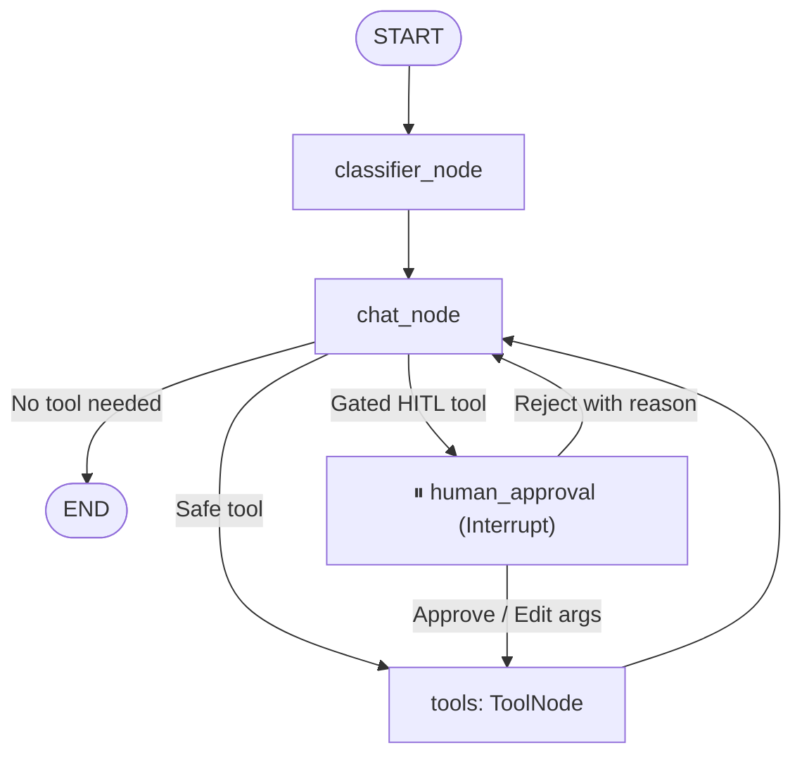

<div align="center">

# 🤖 Agentic AI Chatbot with LangGraph, Hybrid RAG & HITL

**A ChatGPT-style multi-thread AI assistant powered by LangGraph, Groq, Hybrid RAG (FAISS + BM25), Tavily real-time web search, and a full Human-in-the-Loop (HITL) safety pipeline — Dockerized and deployed live on AWS EC2.**

[](https://agentic-chatbot-kobi.duckdns.org/)
[](https://www.python.org/)
[](https://langchain-ai.github.io/langgraph/)
[](https://streamlit.io/)
[](CHATBOT/Dockerfile)
[](https://groq.com/)
[](CHATBOT/LICENSE)

</div>

---

## 🌐 Live Deployment

- **Live HTTPS URL:** [https://agentic-chatbot-kobi.duckdns.org/](https://agentic-chatbot-kobi.duckdns.org/)
- **Container Health Endpoint:** `https://agentic-chatbot-kobi.duckdns.org/_stcore/health`
- **Deployment Stack:** Docker (`python:3.11-slim` + `uv`) + Caddy Reverse Proxy (Auto HTTPS) on Ubuntu AWS EC2 (`16.178.174.90`)

---

## ✨ Key Features

| Feature | Description |
| :--- | :--- |
| 🛡️ **Human-in-the-Loop (HITL)** | Uses LangGraph `interrupt_before=["human_approval"]` to pause before gated actions (`book_stock`, `web_search`, `get_ai_news`, `get_stock_info`). Inspect & **edit tool arguments**, **Approve & Execute**, or **Reject with a reason** directly in the UI, with a live **HITL Audit Log**. |
| 📄 **Hybrid RAG Pipeline** | Upload **PDF, TXT, DOCX, or MD** files. Combines **FAISS** semantic search (`all-MiniLM-L6-v2` embeddings) and **BM25** keyword search via **Reciprocal Rank Fusion (RRF)**. |
| 🧠 **Smart Intent Classifier** | Dedicated `classifier_node` routes queries across 7 intents (`document`, `book_stock`, `stocks`, `weather`, `ai_news`, `web`, `direct`) before tool calling. |
| 🌐 **Real-Time Web & Market Tools** | Live **Weather**, **Stock Prices**, **Today's AI News**, and **Web Search** powered by **Tavily**, plus simulated **Stock Order Booking (`book_stock`)**. |
| 💬 **ChatGPT-Style Multi-Thread UI** | Sidebar chat history (newest at top), isolated per-thread `MemorySaver` state, `⏸` indicator on threads awaiting HITL approval, and token-by-token streaming with live tool badges. |
| 🐳 **Docker & CI/CD Ready** | Self-contained `CHATBOT/` Docker setup with pre-cached HuggingFace embeddings, healthchecks, and a GitHub Actions workflow (`.github/workflows/cicd.yaml`). |
| 📊 **LangSmith Tracing** | Built-in observability for every classifier call, tool execution, and synthesis step. |

---

## 🏗️ Agent Architecture



---

## 📁 Project Structure

```text
Agentic_Chatbot_Using_Langgraph/
├── .github/
│   └── workflows/
│       └── cicd.yaml            # GitHub Actions CI (syntax + Docker test) & CD (AWS)
├── CHATBOT/
│   ├── agentic_chatbot.py       # LangGraph agent, classifier, 6 tools, & HITL gate
│   ├── app.py                   # Streamlit multi-thread UI, streaming & HITL approval panel
│   ├── rag_engine.py            # Document loader, chunking, FAISS + BM25 RRF hybrid search
│   ├── Dockerfile               # Production Docker image (uv + pre-cached MiniLM + healthcheck)
│   ├── docker-compose.yml       # Local & server container orchestration
│   ├── requirements.txt         # Self-contained Python dependencies
│   ├── .env.example             # Template for required API keys
│   ├── .dockerignore            # Excludes secrets & runtime DBs from Docker image
│   ├── .gitignore               # Ignores local .env, DB, and cache files
│   └── LICENSE                  # MIT License
├── .gitignore
└── README.md
```

---

## 🚀 Quick Start

### Option 1 — Run with Docker (Recommended)
```bash
git clone https://github.com/Kobi1003/Agentic_Chatbot_Using_Langgraph.git
cd Agentic_Chatbot_Using_Langgraph/CHATBOT

# Create .env (without quotes around values for Docker)
cp .env.example .env
# Edit .env and add your GROQ_API_KEY, TAVILY_API_KEY, and LANGCHAIN_API_KEY

docker compose up --build -d
```
Open **`http://localhost:8501`** in your browser.

### Option 2 — Run Locally with Conda
```bash
git clone https://github.com/Kobi1003/Agentic_Chatbot_Using_Langgraph.git
cd Agentic_Chatbot_Using_Langgraph/CHATBOT

conda create -n langgraph python=3.11 -y
conda activate langgraph
pip install -r requirements.txt

streamlit run app.py
```

---

## 💡 Example Prompts to Try

| Category | Example Prompt | Default HITL Gate |
| :--- | :--- | :--- |
| 📈🛒 **Stock Booking** | `"Buy 10 shares of AAPL at market price"` | 🔴 **Gated (High Risk)** — Pause, edit qty/ticker, Approve or Reject |
| 🤖 **AI News** | `"What are the latest AI news today?"` | 🟡 **Gated (Medium Risk)** — Confirm before live web query |
| 🌐 **Web Search** | `"Search the web for Nvidia earnings"` | 🟡 **Gated (Medium Risk)** — Confirm or edit search query |
| 🌤️ **Weather** | `"What is the weather in Mumbai today?"` | 🟢 **Auto-runs** *(toggleable in sidebar)* |
| 📄 **Document RAG** | `"Summarise the key points in the uploaded document"` | 🟢 **Auto-runs** *(after uploading a PDF/TXT/DOCX)* |

---

## 🧰 Tech Stack

- **Orchestration:** LangGraph (`StateGraph`, `MemorySaver`, `ToolNode`, `interrupt_before`)
- **LLM:** Groq (`openai/gpt-oss-120b`)
- **Embeddings & Vector Store:** `sentence-transformers/all-MiniLM-L6-v2` + `FAISS`
- **Keyword Search:** `BM25Okapi` (`rank-bm25`) + Reciprocal Rank Fusion
- **Web Search:** `langchain-tavily` / `tavily-python`
- **Frontend:** Streamlit
- **Container & Cloud:** Docker, Caddy (HTTPS), GitHub Actions CI/CD, AWS EC2 (`16.178.174.90`)
- **Observability:** LangSmith

---

## 📜 License

This project is licensed under the [MIT License](CHATBOT/LICENSE).
